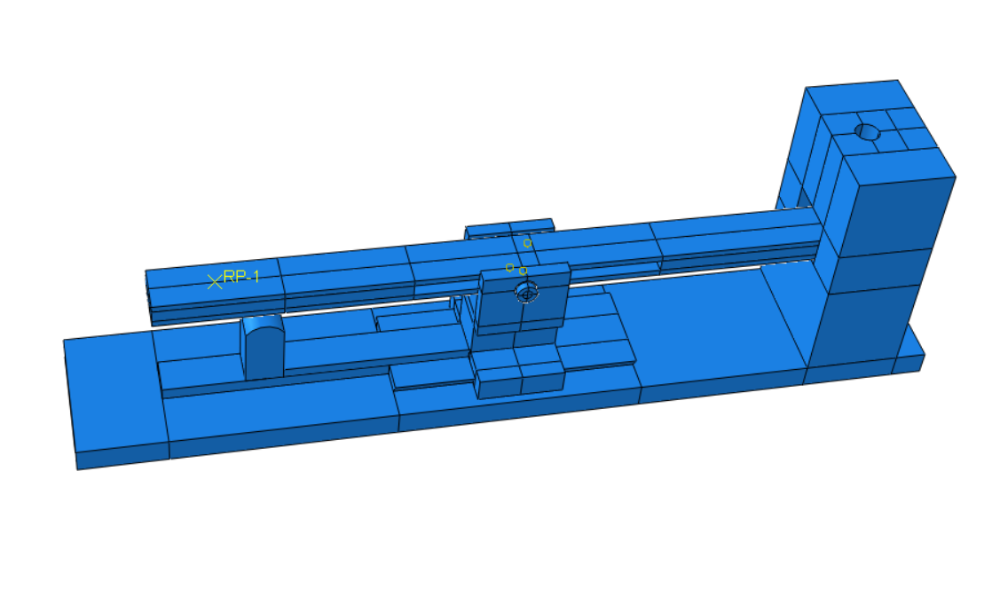
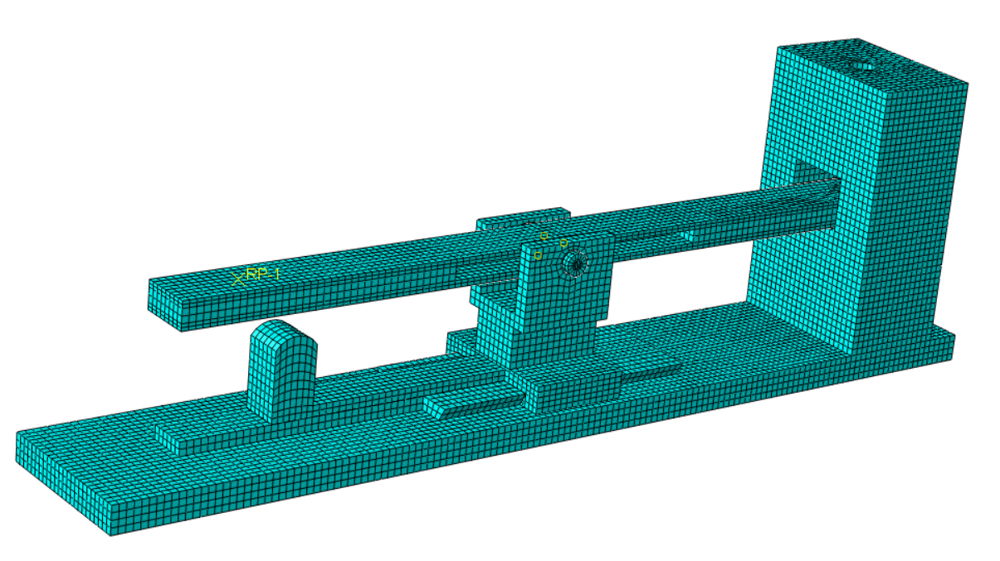
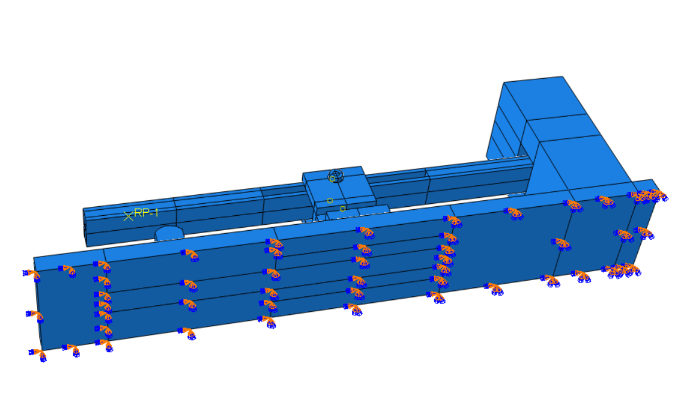
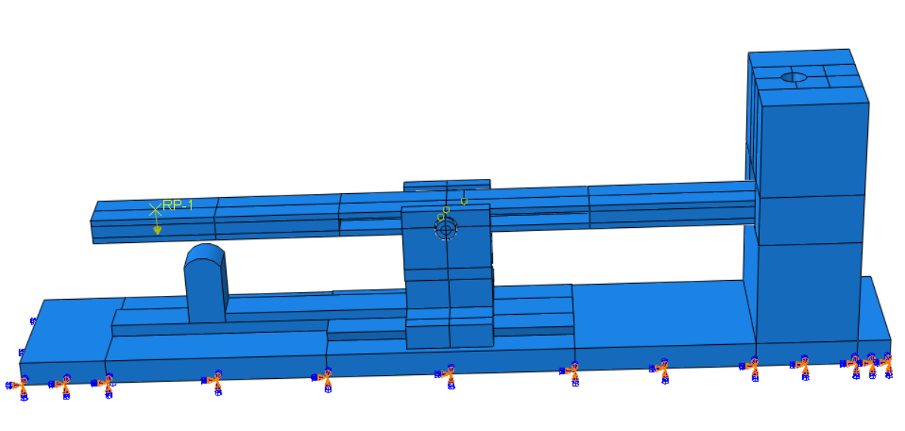
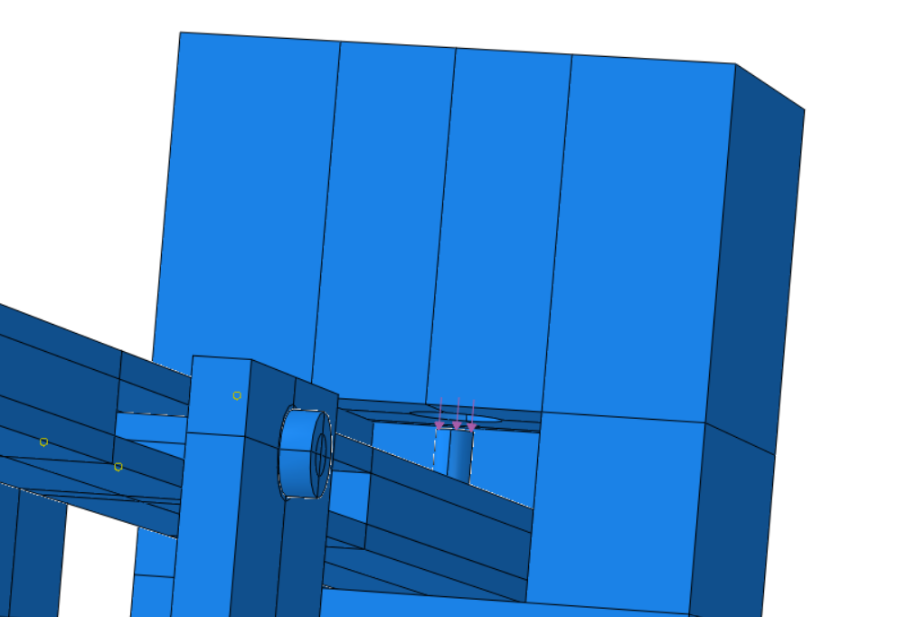
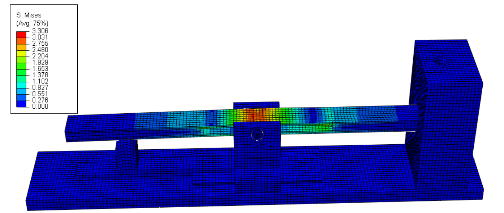
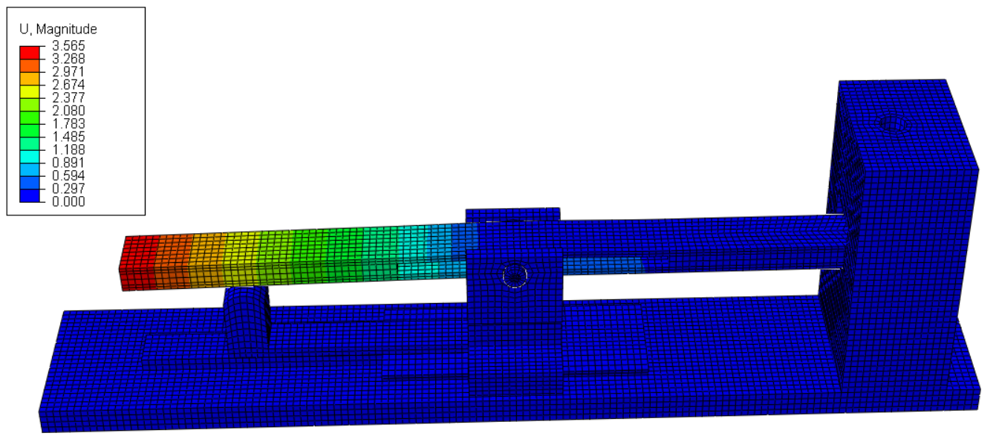
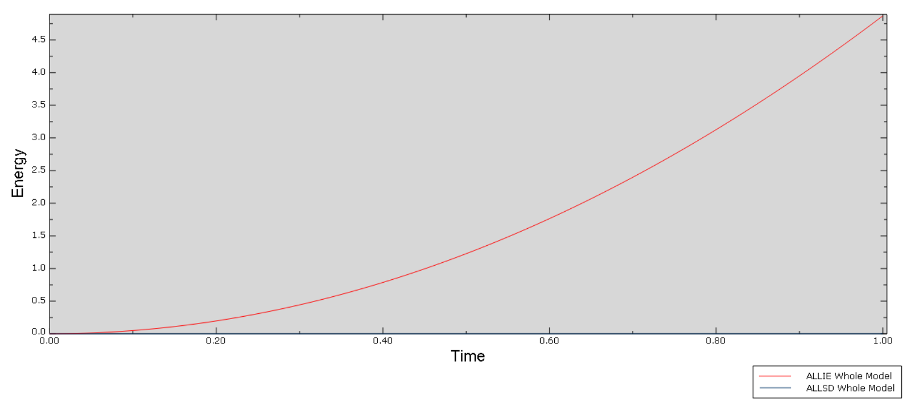

# abaqus-hand-rehabilitation-device
Finite element analysis of a hand rehabilitation device using Abaqus under a representative 4 N load.
# Hand Rehabilitation Device: FEA of the 3D-Printed Lever

Linear static finite element analysis of a 3D-printed lever mechanism for hand therapy exercises, made in Abaqus/CAE. This project is part of my Bachelor's thesis, *Design of a Device for the Rehabilitation of Patients with Hand Conditions*.

The device works as a lever: the patient pushes on the handle, the lever turns around a central pivot (axle), and a spring pushes back on a small peg on the other side. The analysis checks how much the lever bends and where the stress is highest under a **4 N load at the handle**.

## Results at a glance

| Result | Value | Where |
| :--- | ---: | :--- |
| Max von Mises stress | **3.306 MPa** | Lever, near the axle |
| Max displacement | **3.565 mm** | Handle end of the lever |
| Indicative factor of safety | **about 14-17** | Against 45-55 MPa (typical bulk PETG strength) |

The factor of safety is indicative only, see "Limitations" below.

## About the model

- **Geometry:** CAD assembly from PTC Creo Parametric. For the analysis I simplified it in Abaqus: I removed small fillets, manufacturing gaps and clearances, and the adjustment and pretension screws, which are not important for the load path.
- **Design basis:** the lever length (287 mm) and the force-balance relation used below come from earlier work on this device, which my thesis builds on.
- **Software:** Abaqus/CAE (Standard solver), with Creo Parametric for the CAD.
- **Units:** mm, N, MPa.
- **Analysis type:** one static step, linear (geometric nonlinearity off), with automatic stabilization (damping factor 0.0002) to help the contacts settle.

### Parts in the model

| Part name in the files | What it is |
| :--- | :--- |
| `clapa` | The lever (287 mm long, 20 mm wide, 10 mm thick), with a 100 mm guide slot around the pivot |
| `ax_pivot` | The pivot axle (8 mm diameter) |
| `pivot` | The adjustable pivot support that holds the axle |
| `grinda` | The fixed support (base beam) that the pivot support sits on |

## Model setup

### Material
The whole assembly uses one isotropic, linear elastic material for 3D-printed PETG.

| Property | Value |
| :--- | ---: |
| Young's modulus (E) | 2200 MPa |
| Poisson's ratio | 0.40 |

In the real device the parts have a gyroid infill, so the printed material is not fully solid. Using one solid isotropic material is a simplification (see "Limitations").

### Mesh
Structured hexahedral (brick) elements of type C3D8R (8 nodes, reduced integration), made at part level after partitioning the geometry. Global element size is 2.5 mm with curvature control (0.05). The model has about 39,000 elements, and the lever has 6 elements through its 10 mm thickness.

### Supports and connections
- The fixed support (`grinda`) is fixed in all directions (ENCASTRE).
- The lever is connected to the pivot axle with a Tie constraint on the surface of the axle hole, so the lever cannot slide off the axle.
- All other parts touch each other through contact: general contact for all exterior surfaces, plus 13 surface-to-surface contact pairs around the axle, the lever and the pivot support. Normal behaviour is hard contact and the friction coefficient is 0.2.
- The clearances between parts were removed, so they touch from the start of the analysis.

### Loads
- **Handle load:** 4 N pointing down, applied at a reference point 118 mm in front of the pivot. The point is connected to the lever with an MPC Beam constraint, so the force is spread over the lever instead of acting on a single node.
- **Spring:** the spring is **not** modeled. Its push on the peg is replaced by an equivalent pressure. For the lever to be in balance around the pivot, the spring force is F_spring = F_patient x a / b = 4 N x 118 mm / 137 mm = 3.445 N, where a = 118 mm (pivot to handle load) and b = 137 mm (pivot to peg). This is the same force-balance relation used in my thesis. Divided by the area of the 4 mm diameter peg (about 12.57 mm²), it gives a pressure of **0.274 MPa**.

## Results

### Von Mises stress
The highest stress is **3.306 MPa**, on the lever near the axle. The fixed support and the rest of the assembly carry much lower stress.

### Displacement
The largest displacement is **3.565 mm**, at the handle end of the lever. It has three parts: about 0.8 mm is the lever bending, about 1 mm is the lever settling in the pivot, and a small tilt around the pivot adds the rest at the tip, since the handle is far from the axle.

## Checks on the result

- **Force balance:** the moment of the handle load around the pivot is 4 N x 118 mm = 472 N•mm. The spring pressure was chosen to give the same moment on the other side (3.445 N x 137 mm = 472 N•mm), so the lever is in balance, as in a first-class lever.
- **Hand calculation:** the lever is a 20 x 10 mm bar loaded in bending, with a maximum moment of 472 N•mm at the pivot. The nominal bending stress is 6 x M / (b x h²) = 6 x 472 / (20 x 10²) = **about 1.4 MPa**. The model gives 3.3 MPa, about 2.3 times higher. This is the expected direction: the nominal value ignores the guide slot and the axle hole, which remove material from the section and concentrate stress right where the maximum appears. I did not do a hand calculation of the reduced section.
- **Energy:** the strain energy rises smoothly to about 4.85 N•mm, and the energy added by the stabilization is about zero. This means the stabilization does not affect the results.

## Factor of safety

Dividing the typical bulk PETG strength (45-55 MPa) by the peak stress (3.306 MPa) gives a factor of safety of about 14-17. This is an **indicative** number: it uses solid PETG, while the printed part with gyroid infill is weaker.

## Limitations

- The material is solid, isotropic PETG. Real 3D-printed parts have infill and weaker layer bonding, so the real strength is lower than the value used.
- The model is linear: small displacements and no yielding.
- The spring is replaced by a constant equivalent pressure, so the model does not show how the spring force changes as it compresses.
- Results come from a single mesh with reduced-integration elements, and no mesh convergence study was done. The peak stress is next to the axle hole and the slot, which is where results depend most on the mesh.
- The results were not compared with physical measurements.

## Files

- [model/pressure-load.inp](model/pressure-load.inp): Abaqus input file of the final model
